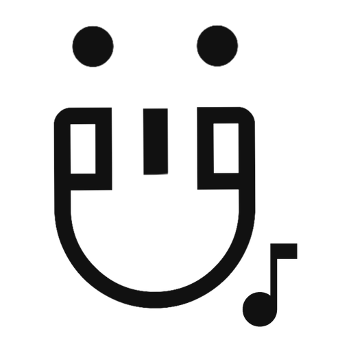
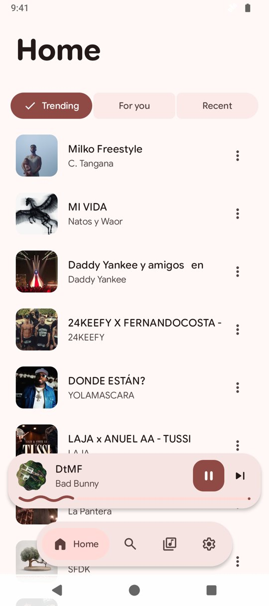
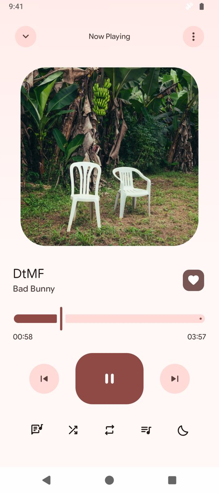
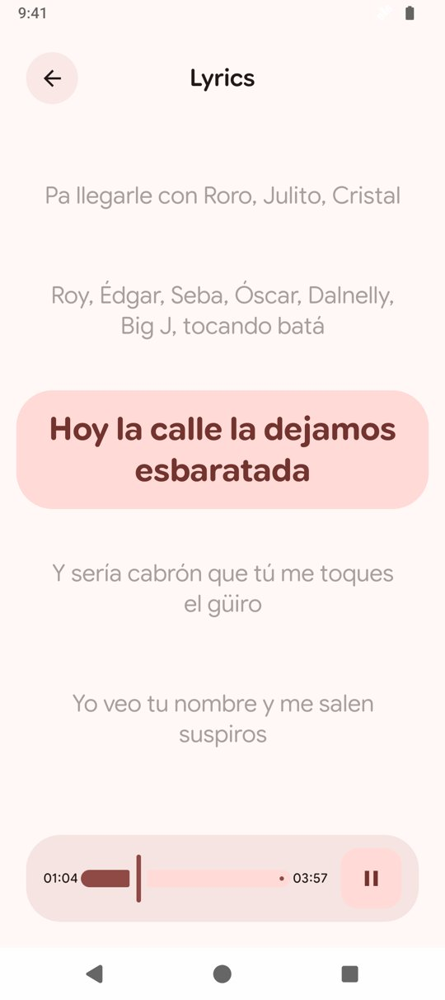
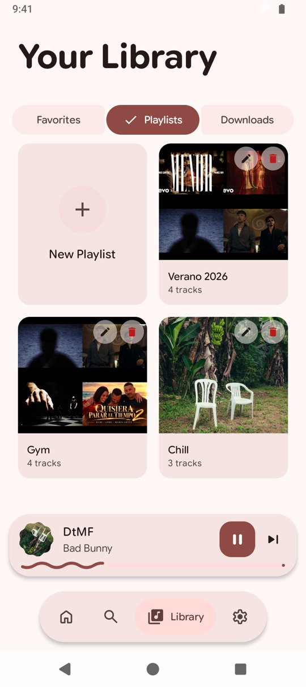
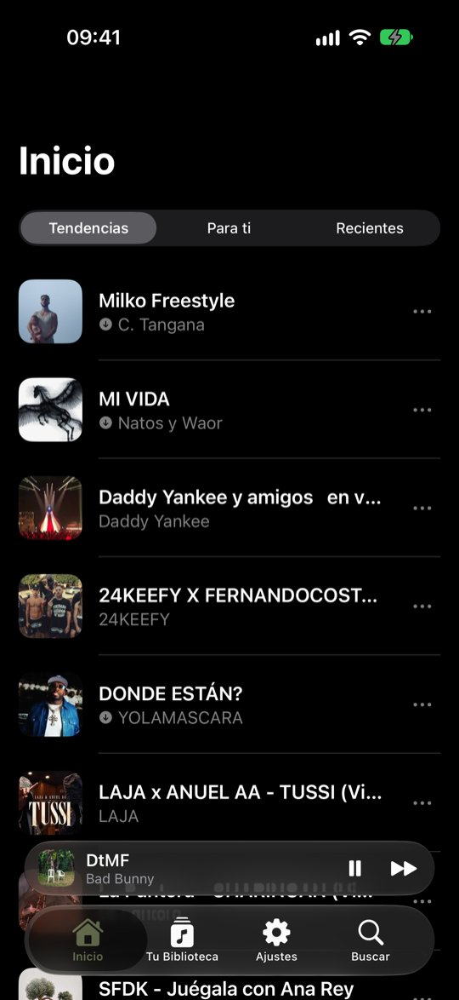
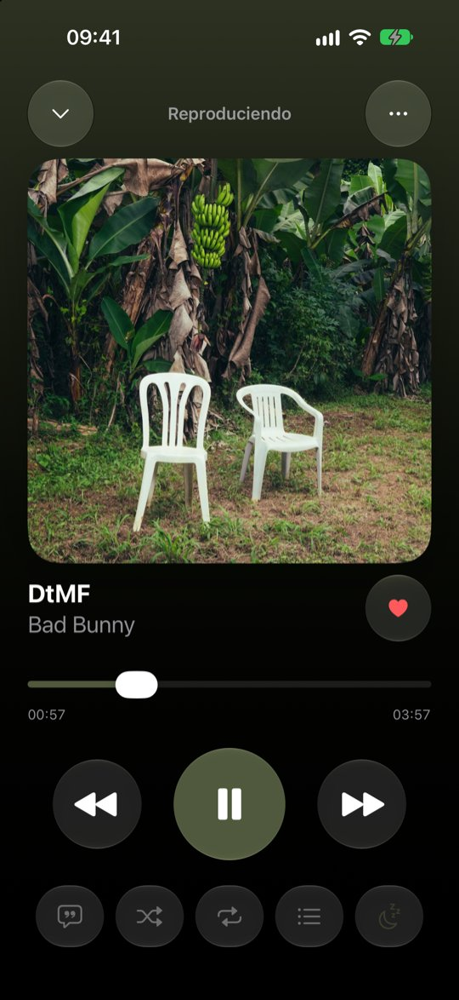
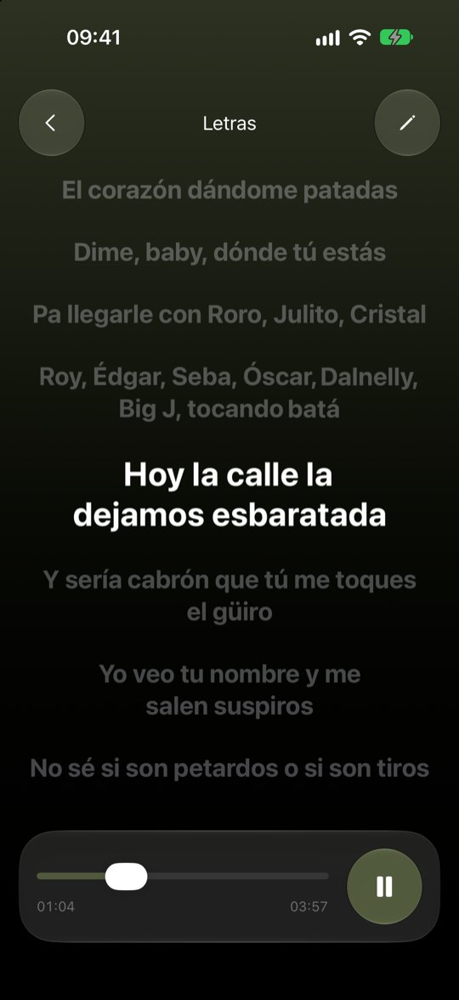
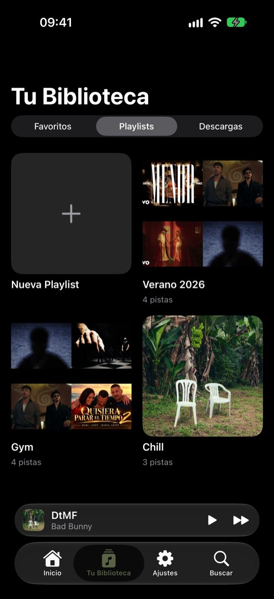

<div align="center">

<picture>
  <source media="(prefers-color-scheme: dark)" srcset="docs/logo-dark.png">
  
</picture>

# HearOn

**A free, open-source music player for Android and iPhone.**<br>
Stream from YouTube Music, save songs for offline listening, and enjoy a native design on each platform.

[](https://github.com/oriilol/HearOn/releases/latest)
[](https://github.com/oriilol/HearOn/releases)


[**Download**](https://github.com/oriilol/HearOn/releases/latest) · [Features](#features) · [Install](#installation) · [Build](#building-from-source)

</div>

---

## Screenshots

### Android · Material 3 Expressive

<p align="center">
  
  
  
  
</p>

### iPhone · Liquid Glass

<p align="center">
  
  
  
  
</p>

## Features

| | |
|---|---|
| 🔥 **Real trending charts** | What's trending in your country, straight from YouTube Music |
| 🎧 **Smart queue** | Radio-style "up next", play next, add to queue, drag to reorder, swipe to remove |
| 🔀 **Mix** | Shuffle any playlist, your favorites or your downloads, extended with similar songs |
| ⬇️ **Offline** | Download songs or let HearOn keep the ones you play for offline listening |
| 🎤 **Synced lyrics** | Line-by-line lyrics that follow the song; add your own if one is missing |
| 📚 **Library** | Favorites, playlists with collage or custom covers, and listening history |
| ⏯️ **Resume** | Pick up exactly where you left off, even after closing the app |
| 🌙 **Sleep timer** | Stop after 15–60 minutes or at the end of the current song |
| 🎨 **Dynamic colors** | The app takes its colors from the cover that's playing |
| 🔒 **Lock screen controls** | Background playback with media controls in the notification / Control Center |
| 🌍 **11 languages** | English, Español, Français, Deutsch, Italiano, Português, Русский, 日本語, 中文, हिन्दी, العربية |
| 🪶 **Lightweight** | No account, no ads, no tracking |

**Android** is built with Kotlin, Jetpack Compose and Material 3 Expressive, with a floating navigation bar, morphing buttons and wavy progress.
**iOS** is built with SwiftUI and Liquid Glass, with a glass mini player above the tab bar and a zoom transition into the player.

## Installation

### Android
1. Download `HearOn-vX.Y.Z.apk` from the [latest release](https://github.com/oriilol/HearOn/releases/latest).
2. Open it and allow installing from your browser or file manager if Android asks.
3. Updates install on top of the previous version. You keep your library.

### iPhone
HearOn isn't on the App Store, so the `.ipa` is unsigned and you sign it with your own Apple ID:
1. Install [AltStore](https://altstore.io), [SideStore](https://sidestore.io) or [Sideloadly](https://sideloadly.io).
2. Download `HearOn-X.Y.Z.ipa` from the [latest release](https://github.com/oriilol/HearOn/releases/latest) and open it with that app.
3. With a free Apple ID the app must be refreshed every 7 days. AltStore and SideStore do it automatically.

Requires **iOS 26** or later.

## Building from source

**Android** (`main` branch)
```bash
git clone https://github.com/oriilol/HearOn.git
cd HearOn
./gradlew assembleDebug
```
Or open the folder in a recent Android Studio. Requires the Android 17 (API 37) SDK.

**iOS** (`ios` branch)
```bash
git clone -b ios https://github.com/oriilol/HearOn.git HearOn-iOS
cd HearOn-iOS
brew install xcodegen && xcodegen generate
open HearOn.xcodeproj
```
Requires Xcode 26 or later. To run on a device, set your team in a `Local.xcconfig` file (`DEVELOPMENT_TEAM = XXXXXXXXXX`).

## Reporting bugs

Found something broken? [Open an issue](https://github.com/oriilol/HearOn/issues) with your device, OS version and the steps to reproduce it.

## Disclaimer

HearOn is an independent project and is not affiliated with, endorsed by or sponsored by YouTube or Google. It is intended for personal use; please respect the rights of artists and content owners.

<div align="center">
<sub>Made with ❤️ in 🇪🇸 by <a href="https://github.com/oriilol">oriilol</a></sub>
</div>
